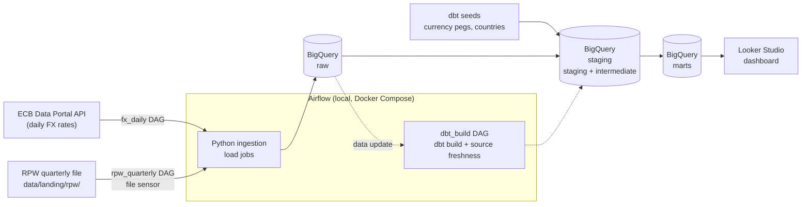

# Remittance Cost Monitor

**How much does it really cost to send money to West Africa, and how much does the recipient actually receive?**

Remittance Cost Monitor is a public data pipeline and dashboard. It combines the World Bank's
[Remittance Prices Worldwide](https://remittanceprices.worldbank.org) (RPW) data with the
[European Central Bank's daily reference exchange rates](https://data.ecb.europa.eu), turns them
into tested analytical tables in BigQuery, and publishes the results in a Looker Studio dashboard.
It focuses on corridors to the West African CFA franc (XOF) countries, starting with Benin, Senegal and Côte d'Ivoire.

> **Status:** work in progress, week 1 of 10 (foundations and smoke test). See [Roadmap](#roadmap).

## Contents

- [The problem](#the-problem)
- [What it answers](#what-it-answers)
- [Architecture](#architecture)
- [Data sources](#data-sources)
- [Tech stack](#tech-stack)
- [Repository structure](#repository-structure)
- [Getting started](#getting-started)
- [How to run](#how-to-run)
- [Data model](#data-model)
- [Design decisions and trade-offs](#design-decisions-and-trade-offs)
- [Limitations and disclaimer](#limitations-and-disclaimer)
- [Roadmap](#roadmap)
- [Documentation](#documentation)

<!-- TODO: add a short "Why I built this" section here, in your own words. -->

## The problem

People sending money home compare providers with little transparency. Fees, exchange rate margins
and delivery methods vary a lot between providers and corridors. The data to compare them exists,
but it is published quarterly in raw files that are hard to explore.

## What it answers

1. What is the average total cost (%) of sending money on a given corridor?
2. Which provider type is cheapest: banks, money transfer operators, mobile operators or post offices?
3. Are corridors getting cheaper over time, quarter by quarter?
4. How many XOF does the recipient receive for a standard transfer ($200 and $500 equivalents)?
5. How is the data ingested, tested and documented?

## Architecture



1. **Ingest.** Python writes source data into the BigQuery `raw` dataset using load jobs, one
   partition at a time.
2. **Transform and test.** dbt cleans the raw data (staging), joins and enriches it
   (intermediate), and builds the dashboard tables (marts). Every model is tested.
3. **Orchestrate.** Airflow runs the ingestion on a schedule (FX) or when a new file lands (RPW),
   then triggers dbt whenever new data arrives.
4. **Serve.** Looker Studio reads the `marts` dataset.

| DAG | Trigger | Steps |
|---|---|---|
| `fx_daily` | Daily, after the ECB publication | fetch → validate → load → emit FX data update |
| `rpw_quarterly` | New file in the landing folder | detect → validate → load → archive → emit RPW data update |
| `dbt_build` | FX or RPW data update | `dbt build` (models and tests) → `dbt source freshness` |
| `fx_backfill` | Manual, with a date range | fetch and load a range of dates |

## Data sources

| Source | Content | Access | Frequency |
|---|---|---|---|
| [World Bank Remittance Prices Worldwide](https://remittanceprices.worldbank.org) | Fees, exchange rate margins and total cost per corridor, provider and service | Manual download (see [below](#4-download-the-rpw-file)) | Quarterly |
| [ECB euro foreign exchange reference rates](https://data.ecb.europa.eu/data/datasets/EXR) | Units of foreign currency per 1 EUR | SDMX REST API, no key | Working days |
| Fixed parity (dbt seed) | 1 EUR = 655.957 XOF | `dbt/seeds/currency_pegs.csv` | Fixed |

**Credits.** Remittance price data: World Bank, Remittance Prices Worldwide. Exchange rate data:
European Central Bank. Both are used under their respective terms of use. Raw RPW files are not
redistributed in this repository.

## Tech stack

| Layer | Tool |
|---|---|
| Orchestration | Apache Airflow 3.3.2, local Docker Compose (LocalExecutor) |
| Warehouse | Google BigQuery, sandbox mode (no billing) |
| Transformation and tests | dbt Core 1.12 with dbt-bigquery |
| Ingestion | Python 3.12, `google-cloud-bigquery` (load jobs) |
| Dashboard | Looker Studio |
| Quality | ruff, pytest, sqlfluff, `dbt parse`, pre-commit |
| CI | GitHub Actions, no cloud credentials |
| Python environment | [uv](https://docs.astral.sh/uv/) (`pyproject.toml` + `uv.lock`) |

## Repository structure

```
airflow/              Airflow image (Dockerfile), docker-compose.yaml, dags/
ingestion/            ecb.py, rpw.py, common/ (settings, BigQuery helpers)
dbt/                  dbt project: models/{staging,intermediate,marts}, seeds/, macros/, tests/
tests/                pytest unit tests and fixtures (no network)
scripts/              smoke test, corridor check, backfill helpers
data/landing/rpw/     raw RPW files (git-ignored, downloaded manually)
docs/                 PRD, technical specification, delivery plan
.env.example          every setting, documented
```

## Getting started

### Prerequisites

- [uv](https://docs.astral.sh/uv/getting-started/installation/) (it installs Python 3.12 for you)
- [Docker Desktop](https://docs.docker.com/get-started/get-docker/) with at least 4 GB of memory
- [Google Cloud CLI](https://cloud.google.com/sdk/docs/install)
- A Google Cloud project with [BigQuery sandbox](https://cloud.google.com/bigquery/docs/sandbox)
  enabled (no billing account needed)

### 1. Clone and install

```bash
git clone https://github.com/NobelAgossa/remittance-cost-monitor.git
cd remittance-cost-monitor
uv sync --all-groups
uv run pre-commit install   # optional: run the checks before each commit
```

### 2. Configure

```bash
cp .env.example .env
cp dbt/profiles.example.yml dbt/profiles.yml
```

Fill in `.env`: every variable is explained in [.env.example](.env.example). At minimum set
`GCP_PROJECT_ID`, `BQ_LOCATION`, `CLOUDSDK_CONFIG` (an absolute path) and `FERNET_KEY`.
Generate the Fernet key with:

```bash
uv run --no-sync python -c "from cryptography.fernet import Fernet; print(Fernet.generate_key().decode())"
```

Both `.env` and `dbt/profiles.yml` are git-ignored. Never commit them.

### 3. Set up Google Cloud

1. In the BigQuery console, create the `raw`, `staging` and `marts` datasets in the location you
   set as `BQ_LOCATION`. dbt creates the dev datasets (`staging_dev`, `marts_dev`) itself.
2. Log in with application default credentials, in a gcloud folder dedicated to this project
   (use the same path as `CLOUDSDK_CONFIG` in `.env`):

   ```bash
   CLOUDSDK_CONFIG=$HOME/.config/gcloud-remittance gcloud auth application-default login
   ```

No service account key file is used, locally or in Airflow: the credentials file is mounted
read-only into the Airflow containers.

### 4. Download the RPW file

RPW data is not committed to this repository. Download the latest dataset from the
[Remittance Prices Worldwide website](https://remittanceprices.worldbank.org) (data download
section) and place the file in `data/landing/rpw/`.

## How to run

Run every command from the repository root. dbt and the scripts read their settings from
environment variables, so load `.env` into your shell first:

```bash
set -a && source .env && set +a
```

### Quality checks

These are the same checks CI runs. They need no cloud access.

```bash
uv run --no-sync ruff format --check .                               # format
uv run --no-sync ruff check .                                        # lint
uv run --no-sync pytest                                              # unit tests
uv run --no-sync sqlfluff lint dbt                                   # SQL lint
uv run --no-sync dbt parse --project-dir dbt --profiles-dir dbt      # dbt project validity
```

### Sandbox smoke test

Proves the design works under the BigQuery sandbox: loads the same partition twice with
`WRITE_TRUNCATE` (rows must be replaced, not doubled), loads a dbt seed, builds a dbt `table`
model with its tests, then deletes its test table.

```bash
uv run --no-sync python -m scripts.smoke_test
```

Each step prints `PASS` or `FAIL` with the exact error.

### dbt

```bash
uv run --no-sync dbt build --project-dir dbt --profiles-dir dbt                     # dev datasets
uv run --no-sync dbt build --project-dir dbt --profiles-dir dbt --target prod       # dashboard datasets
```

The `dev` target (default) writes to suffixed datasets such as `staging_dev`, so experiments
never touch dashboard data. Only `prod` writes to `staging` and `marts`.

### Airflow

```bash
docker compose -f airflow/docker-compose.yaml --env-file .env up -d     # start (builds the image on first run)
docker compose -f airflow/docker-compose.yaml --env-file .env down      # stop
```

Open <http://localhost:8080> and log in with the user and password set in `.env`. DAGs start
paused: unpause one, then trigger it. The `hello` DAG checks that the image, the mounted
`ingestion` package and the settings all work.

## Data model

| Layer | Dataset | Models |
|---|---|---|
| Sources | `raw` | `ecb_fx_rates` (partitioned by rate date), `rpw_prices` (partitioned by quarter start date) |
| Seeds | `staging` | `currency_pegs`, `countries` |
| Staging | `staging` | `stg_ecb__fx_rates`, `stg_rpw__prices`, `stg_reference__currency_pegs` |
| Intermediate | `staging` | `int_fx_rates_daily_filled`, `int_fx_rates_to_xof`, `int_rpw_services_in_scope` |
| Marts | `marts` | `dim_corridor`, `dim_provider_type`, `fct_remittance_prices`, `mart_corridor_cost_trends`, `mart_cheapest_services`, `mart_amount_received` |

**Estimated amount received:**
`send_amount × (1 − total_cost_pct) × mid_market_rate_to_XOF`, using the quarter's average
ECB rate converted to XOF through the EUR peg.

**Tests:** `not_null`, `unique`, `accepted_values` and `relationships` on key columns; singular
tests for plausible cost ranges, duplicate services and missing in-scope corridors; source
freshness on `raw.ecb_fx_rates` (warning after 4 days, error after 7).

## Design decisions and trade-offs

| Decision | Why | Trade-off |
|---|---|---|
| **BigQuery sandbox** | Zero cost, real cloud warehouse | No DML, no streaming, tables expire after 60 days |
| **Load jobs with `WRITE_TRUNCATE` on one partition** | The only idempotent write the sandbox allows: re-running a date or quarter replaces it instead of duplicating it | Each load rewrites a whole partition |
| **Every dbt model is a `table` (full rebuild)** | Incremental models and snapshots need DML | Slower builds as data grows; fine at this volume |
| **Rebuildable from sources** | Sandbox tables expire after 60 days | Needs an FX backfill command and kept RPW files |
| **File-triggered RPW ingestion** | RPW has no API; files arrive quarterly | A manual download step remains |
| **Data contract validated at ingestion** | RPW format can change between releases | Every format change needs a contract update |
| **Separate dev and prod datasets** | Experiments never touch the dashboard | More datasets to manage |
| **Local Airflow with Docker Compose** | Free, close to a real deployment | Runs only while the machine is on |
| **Application default credentials, no key files** | Nothing secret can leak into git | Each developer logs in locally |
| **CI without cloud credentials** | Safe for a public repository | CI checks code and SQL, not the warehouse |

**Upgrade path:** enabling billing (while staying within the BigQuery free tier) removes the
sandbox limits, after which incremental models can be introduced.

## Limitations and disclaimer

- Figures are **estimates for analysis**, not a substitute for actual prices quoted by providers.
- The amount received is an **approximation** based on the ECB mid-market rate, not the rate a
  provider actually applies.
- Only sending currencies covered by the ECB reference rates are supported (for example EUR, USD, GBP).
- RPW data is quarterly, so the dashboard is only as recent as the latest RPW release.
- On weekends and holidays the ECB publishes no rate; the last known rate is carried forward and
  flagged.
- Sandbox data expires after 60 days and must be rebuilt from the sources.

## Roadmap

| Week | Step | Status |
|---|---|---|
| 1 | Foundations and sandbox smoke test | In progress |
| 2 | Corridor check and RPW data contract | Planned |
| 3 | ECB ingestion | Planned |
| 4 | RPW ingestion | Planned |
| 5 | dbt staging and intermediate models | Planned |
| 6 | dbt marts | Planned |
| 7 | Airflow DAGs | Planned |
| 8 | Looker Studio dashboard | Planned |
| 9 | Documentation and dbt docs site | Planned |
| 10 | Case study and article | Planned |

## Documentation

- [Product requirements](docs/PRD.md): goals, users, scope and success criteria
- [Technical specification](docs/TECH_SPEC.md): architecture, data sources, models and DAGs
- [Delivery plan](docs/PLAN.md): week-by-week steps and "done when" checks
